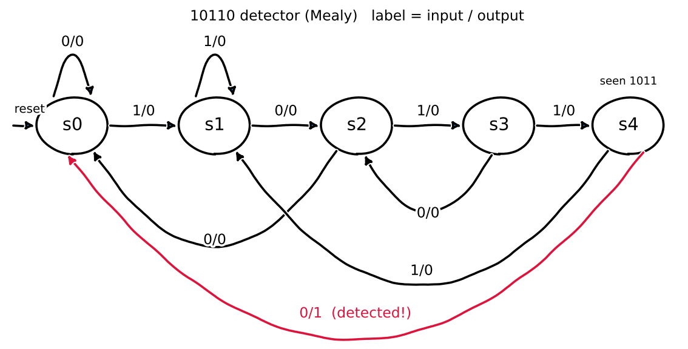

# 10110 Sequence Detector (Mealy FSM)

A Mealy state machine in Verilog that detects the bit sequence **10110** on a serial input. It is **non-overlapping**, so after a match the machine starts again from the beginning.

## Mealy machine in short

In a Mealy machine the output depends on the **current state and the current input**. So the output can change as soon as the input changes, without waiting for the next clock edge.

Here, `out = 1` only when the machine is in state `s4` (already saw `1011`) and the input is `0`.

## Block diagram

```
          +------------------+
 in  ---->|                  |
 clk ---->|  mealy_machine1  |----> out
 rst_n -->|                  |
          +------------------+
```

| Port    | Dir    | Description                              |
|---------|--------|------------------------------------------|
| `in`    | input  | Serial input bit                         |
| `clk`   | input  | Clock (rising edge)                      |
| `rst_n` | input  | Active-low asynchronous reset            |
| `out`   | output | 1 when 10110 has just been detected      |

## States

| State | Meaning (bits seen so far) |
|-------|----------------------------|
| `s0`  | nothing useful             |
| `s1`  | `1`                        |
| `s2`  | `10`                       |
| `s3`  | `101`                      |
| `s4`  | `1011`                     |

## State diagram

Each arrow is labelled `input / output`. The red arrow is the only place where the output becomes 1.



## Example

```
in  : 1 0 1 1 0 1 1 0
out : 0 0 0 0 1 0 0 0
              ^ 10110 detected here
```

After the first match the machine goes back to `s0`, so the leftover `110` at the end does not count as a new match (non-overlapping).

## Design notes

- Two `always` blocks: a sequential block for the state register and a combinational block for the next state.
- The output is a continuous `assign` using the current state and `in`.
- The state register uses non-blocking assignments (`<=`) to avoid race conditions with the testbench.

## Testbench (self-checking)

The testbench does not need waveform checking. It has:

1. **Reference model:** `hist` holds the last 4 inputs. `exp_out = (hist == 1011) && (in == 0)`. After a match `hist` is cleared, which makes it non-overlapping.
2. **Checker:** every cycle it compares `out` with `exp_out` using `!==` (so X values are also caught) and counts errors.
3. **Stimulus:** reset, then 20 rounds of 50 random bits followed by the directed sequence `10110`.
4. **Result:** prints `TEST PASSED` or `TEST FAILED` at the end. It also counts matches, so a test that never sends the sequence cannot pass.

```
 in --+--------------> DUT --> out --+
      |                              +--> compare --> PASS / FAIL
      +--> hist --> exp_out ---------+
```

## Files

| File                                                   | Description                  |
|--------------------------------------------------------|------------------------------|
| `10110_sequence_Detection/mealy_machine1.v`            | Detector design (RTL)        |
| `10110_sequence_Detection/mealy_machine1_tb.v`         | Self-checking testbench      |
| `state_diagram.png`                                    | State diagram image          |

## How to run

With Icarus Verilog:

```
cd 10110_sequence_Detection
iverilog -g2012 -o sim mealy_machine1.v mealy_machine1_tb.v
vvp sim
```

Expected last line: `TEST PASSED: <checks> checks, <matches> matches`.
